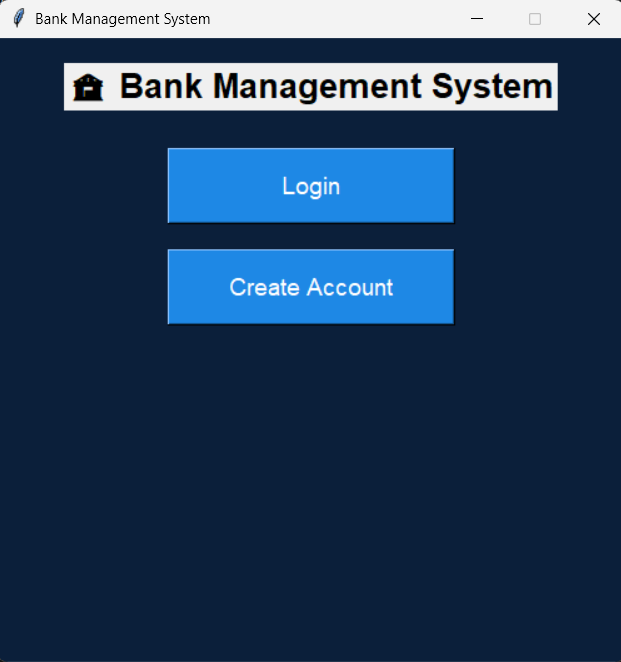
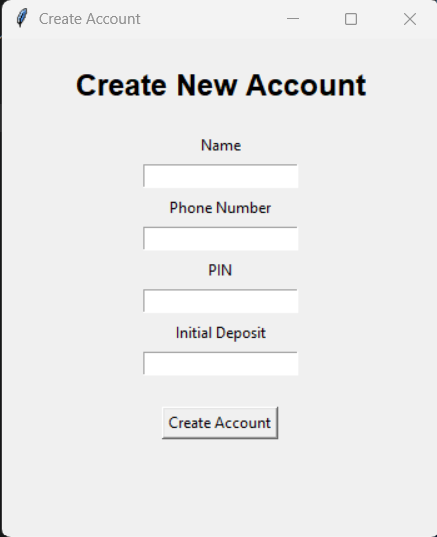
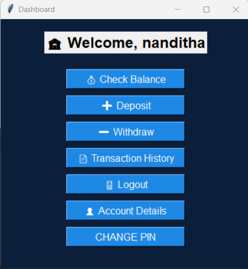

# Bank Management System

A simple desktop based Bank Management System built using Python,Tkinter and SQLite

## Features

- Create a new bank account
- User login with phone number and PIN
- Check account balance
- Deposit money
- Withdarw money
- View transaction history
- View account details
- Change PIN
- Logout

## Technologies used

- Python
- Tkinter
- SQLite
- SQL

## Project structure

-'main.py' - Contains the main Python code and graphical user interface.
-'gui.py' - Contains the graphical user interface
-'database.py' - Handles SQLite database operations.
-'bank.db' - SQLite database used to store account and transaction data.
-'screenshots/' - Conatins the creenshots of the application.
-'README.md' - Documentation and information about the project.

## Screenshots

### Login


### Create account


### Dashboard


## How to Run

1. Make sure Python is installed.
2. Open the project folder in VS Code.
3. Run the following command:

```bash
python main.py
```

4. The Bank Management System will open.

## Future Improvements

- Add password/PIN encryption for better security.
- Add an admin panel for managing accounts.
- Add a web-based version of the application.
- Add email or SMS notifications for transactions.
- Improve the user interface and overall design.

## Author

**Nanditha P.**

Computer Science and Engineering Student